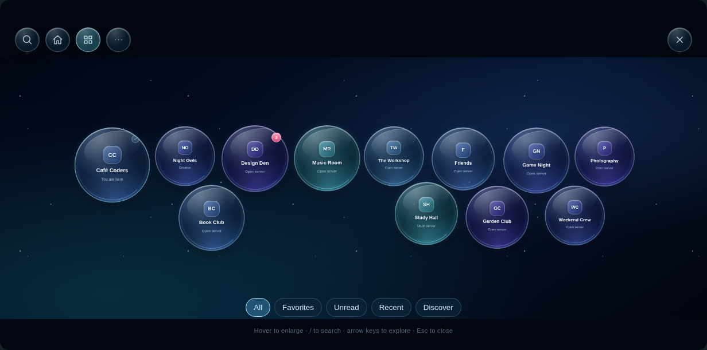
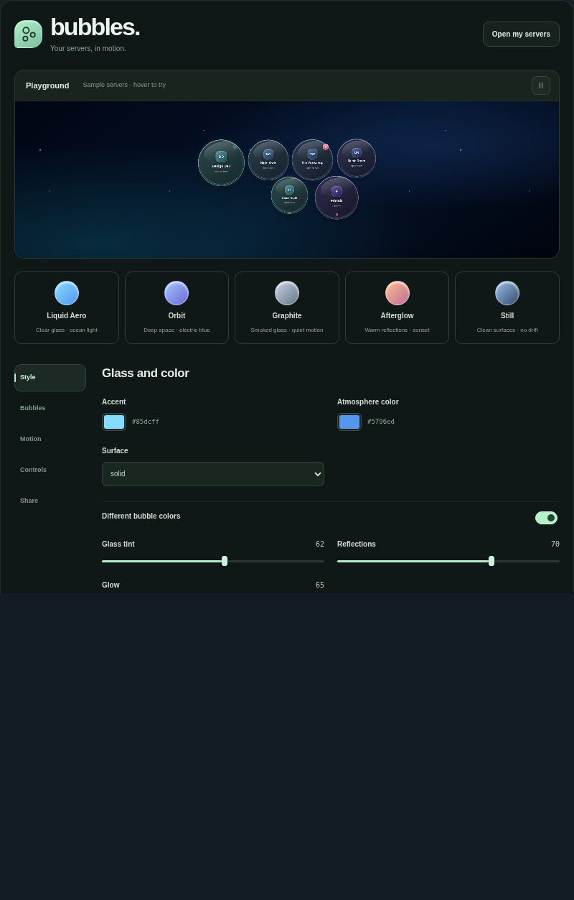

# Server Bubbles for Vencord

A floating server switcher with glass bubbles, search, favorites and a live customization studio. Based on [Server Bubbles for BetterDiscord](https://github.com/pistolswang013/ServerBubbles), with a separate React implementation for Vencord.

This is a custom userplugin. It is not included in official Vencord releases.

## Install

1. Set up a [Vencord source build](https://docs.vencord.dev/installing/).
2. Download or clone this repository.
3. Copy the **`serverBubbles` folder** into your Vencord checkout at **`src/userplugins/serverBubbles`**. Create `userplugins` if needed.
4. From the Vencord checkout, run `pnpm build`, restart Discord, and enable **ServerBubbles** in Vencord's plugin settings.

The final entry point must be `Vencord/src/userplugins/serverBubbles/index.tsx`. Copy the whole folder, including its styles and supporting files. The repository itself is not the plugin folder.

See Vencord's [custom plugin instructions](https://docs.vencord.dev/installing/custom-plugins/) for the full setup. No extra runtime dependencies are needed.

## Use

- Click the floating launcher or press **Ctrl + Shift + Space**.
- Hover a bubble to enlarge it, then click to open the server.
- Press **/** to search by name, initials or folder name.
- Use the arrow keys to move between bubbles, **Enter** to open one, and **Escape** to close.
- Pin favorites with the star or the right-click menu. Filters show favorites, unread or recently opened servers.
- Turn off the overview to explore with the wheel, screen edges or touch dragging. **Shift + wheel** moves sideways.
- Drag the launcher to move it. The normal server list stays visible unless you hide it in the studio.

Open **Customize bubbles** from the plugin settings, the bubble window or Vencord Toolbox. The studio includes five presets, local wallpapers, bubble sizing, motion controls, frame limits and a sample playground.

Shared looks work with BetterDiscord's version 1 look format. Copy, download or import a look from the Share tab. Exports leave out server IDs, favorites, history, launcher position and wallpapers. Settings are stored locally through Vencord; BetterDiscord settings are not migrated automatically.

## Preview

The screenshots use sample servers in a local preview.




## Development

`serverBubbles/index.tsx` registers the launcher through Vencord's ServerList API and opens native modals. The field and studio are React components. Discord's stores supply server order, folders, unread counts and navigation.

For local tests:

```sh
npm ci
npm test
npm run test:browser
```

The browser check needs Chromium at `/usr/bin/chromium`, or a path supplied with `BROWSER_PATH`. It uses mocked Vencord APIs; it does not connect to a Discord account.

The port was checked against Vencord commit `32c90633ce6a95d7e56c95479efbb431bacf1eac`. Desktop and web builds, TypeScript, plugin lint, style lint, unit tests and browser checks pass. Live testing in Discord is still needed.

Before an upstream submission, replace the `0n` author ID in `index.tsx` with your Discord user ID, test on your current Discord build, and review [Vencord's contribution rules](https://github.com/Vendicated/Vencord/blob/main/CONTRIBUTING.md). Acceptance is up to the maintainers.

## License

GPL-3.0-or-later. The original Server Bubbles artwork and presets retain their MIT notice in [LICENSE.ServerBubbles](LICENSE.ServerBubbles).
